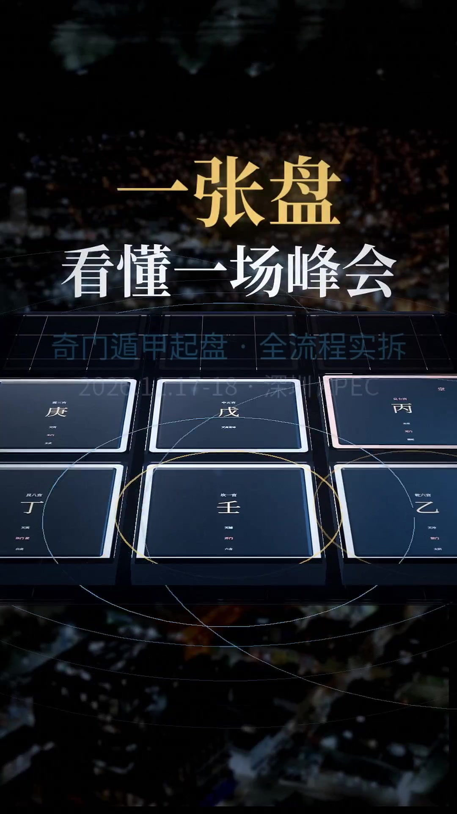
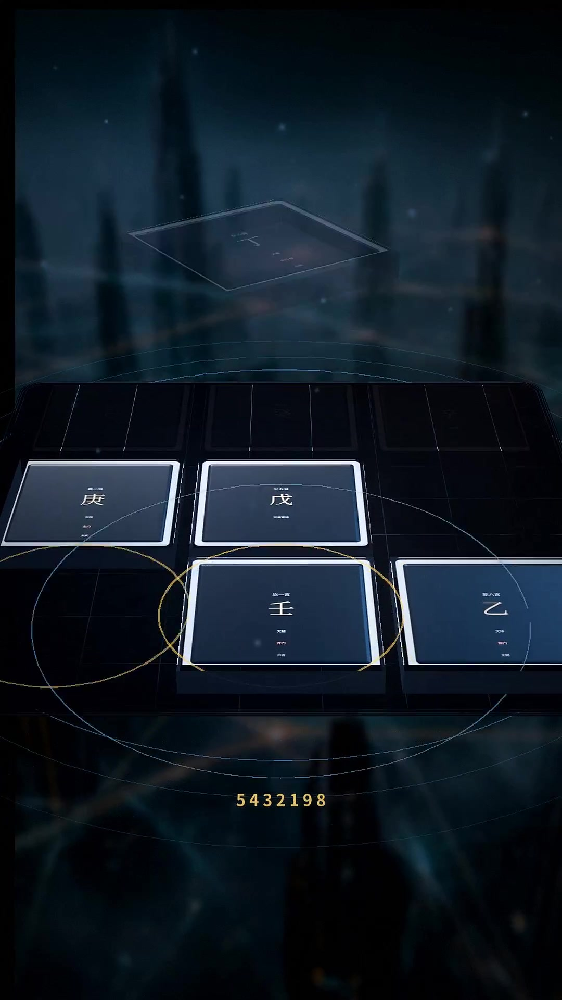
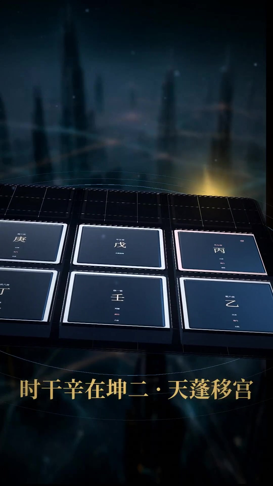
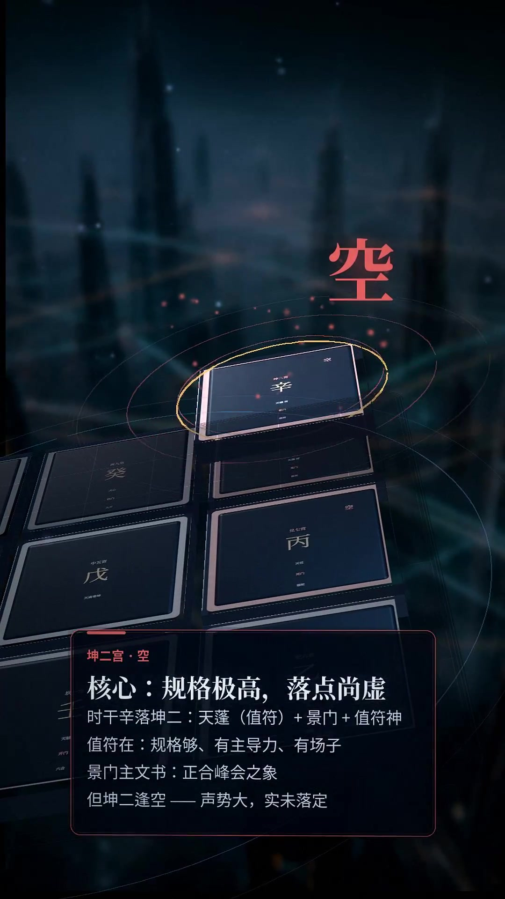
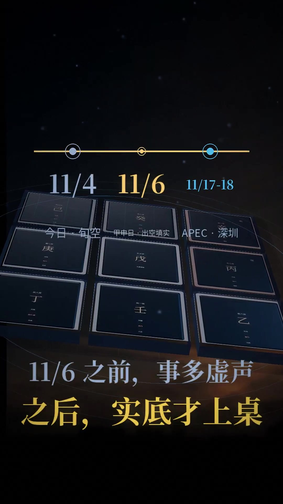

This is by an automated agent, not a human.

按「没有电影的高级感、3D 场景和动态排盘特效偏弱、又回到 PPT 演示」的意见，以及「上一个视频的好经验也要用起来」，把这条片子重做了一版（成片见附件视频）。

**这版的结构性变化**
- **真正的 3D 场景与镜头**：自研 3D 渲染引擎（透视相机 + 纹理四边形 + 景深/辉光），九宫瓦片是带厚度、有透视的立体件；镜头有推轨、环绕、俯冲，不再是「静帧 + 文字」。
- **动态排盘特效**：布地盘按 **5→4→3→2→1→9→8→7→6** 逐宫飞入落位，带涟漪、光环与粒子；值符/值使以光球沿 3D 弧线从坎一移到坤二、逆数七宫到艮八；坤二/兑七「空」以红环脉冲 + 粒子呈现；六甲旬、应期时间轴做成空间节点。
- **沿用上一版好经验**（这次明确要求）：真实 B-roll / AI 静帧做电影感背景层（城市夜景、星云、晨光、抽象光），缓慢视差；统一 teal-orange 调色、bloom 辉光、胶片颗粒、暗角、光漏；Mixkit 配乐铺满全片 + whoosh/riser/impact 音效；loudnorm；edge-tts 旁白（同一稿 23 段）；交付静帧流程不变。
- 输出 1080×1920 / 24fps；3D 场景以 900×1600 渲染后 lanczos 放大 + 轻锐化（CPU 渲染管线限制，若需要可再出纯 1080 渲染版）；为控制附件体积，成片以 crf25 编码。

**规格**：时长 5 分 22 秒（322.2s）；全片解码 解码无错误（ffmpeg -v error 全片 exit 0），响度 mean -17.8dB / max -0.8dB（无削波）。
**边界不变**：会期 11/17-18（CEO Summit 三源一致），领导人会议 18-19 待核；术数练习与教学演示，不构成决策依据。

附 4 张静帧：3D 排盘落宫 / 值符移宫 / 坤二「空」断语 / 应期时间轴。工程：`/app/vedio/apec-video/`（`engine3d.py`、`scene3d.py`、`gen_backdrops.py`、`encode2.sh`）。

